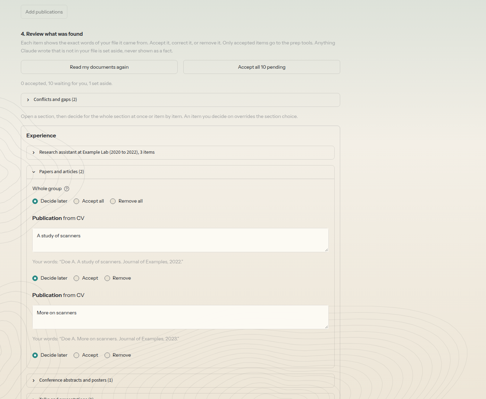
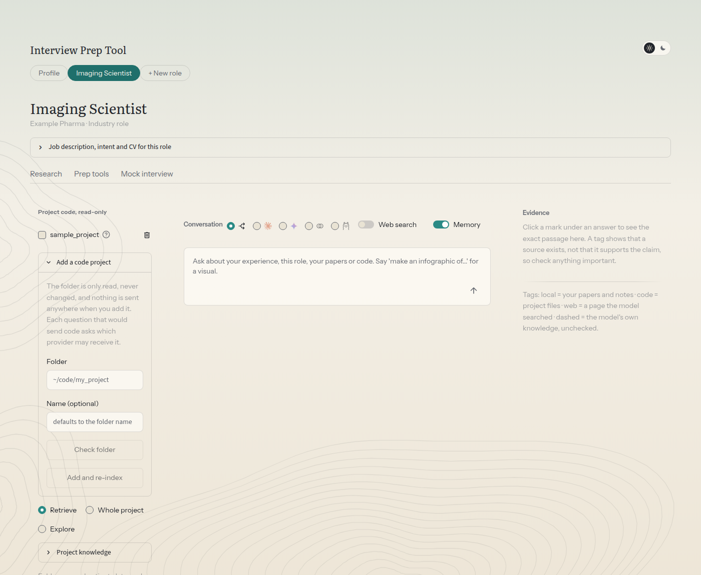

# 🎯 Interview Prep Tool

## 👋 About this project

This application started out of curiosity, interest, and some frustration. Notes, PDFs, and codebases were scattered everywhere. Remembering or summarizing years of work meant jumping between multiple files, research papers, and codebases. Neither of us is a software engineer, and we built much of the structure and design along the way with Claude's help. The goal was to make our lives easier and to test how much Claude Code could build. It became a personal project to learn RAG (retrieval-augmented generation), harnesses, and agents, and how to bring them together for a specific use case. It may not be a perfect tool, but it taught a lot about the current technologies in the field of artificial intelligence. Updates may come slowly. Next steps include strengthening the existing extraction features while learning more, and fixing the interface and design problems that affect how people use it.

## 🎯 What it is

Prepare for a job interview from your own documents, with every statement about you traced back to where it came from.

Give it your CV, a few lines about yourself and your publications once. For each job you are applying for, add a role: paste the job description, say what you want the application to show, and attach the CV you are sending. Each role then gets:

- **Research**: ask questions of your papers, notes and (optionally) project code, and of the web, with every claim tagged by origin.
- **Prep tools**: a gap analysis against the job, "tell me about yourself" in 1-minute and 3-minute versions, a STAR story bank, likely questions (with deep-dives into your own publications for academic roles).
- **Mock interview (beta)**: a text interview, one question at a time, behavioral or technical, with written feedback and a stronger version of each answer.

It runs on your own computer. Your documents stay in a folder here, and nothing is uploaded anywhere except the passages sent to the model provider you choose.

**It never invents your experience.** Everything about you has to come from your documents and is marked with the document it came from. General advice is marked `model knowledge`. Anything your documents do not cover is shown as a `GAP:` line for you to fill in. Figures that appear in a draft but in none of your documents are flagged for you to check. Models can still make mistakes, so read every draft before you use it.



**A role's page:** your sources and code projects on the left, with the **Add a code project** box, the conversation in the middle, and the evidence for each citation on the right. The tabs above switch between Research, Prep tools and Mock interview.



These screenshots use made-up sample data and the offline demo mode.

## ✨ Features

**🧑‍💼 Your profile and roles**
- One shared profile built from your CV (PDF, Word, Markdown or text), an optional "about you" text and optional publications. You can read and correct it.
- Every file you save is read by Claude and turned into organised items, grouped by section like a CV (jobs, credentials, papers, abstracts, talks, skills, awards, service, extracurriculars, recommendations). Each item shows the exact words of your file it came from. You accept, correct or remove each one. Only accepted items go to the prep tools. Anything not found in your file is set aside, and missing dates or results are listed as gaps.
- One tab per role, marked Industry or Academic. Each role has its own pasted job description (saved as a Markdown file), your intent, a CV for that role, and its own chats.

**📚 Research, in every role**
- Questions answered from your own documents, with every claim tagged by where it came from: `local` (your files, with page numbers), `code` (file and line range), `web` (a page the model searched) or `model knowledge`. Click a tag to read the exact passage.
- Claude (through your Claude Code login or an API key), Gemini and Ollama. Auto picks one, you can force one, or compare Claude and Gemini side by side.
- Optional web search, conversation memory, saved chats, source preview, and adding papers by upload or link.
- Project code, read-only: add a project from the Sources panel (no settings file to edit), then ask with Retrieve, Whole project or Explore. A **deep read** builds a lasting "project knowledge" document, even for a large project: it is read in areas by several workers, by Claude or by an Ollama model you choose. Code is only sent after you choose the provider each time.
- Infographics through Gemini's image model.

**🎤 Interview preparation, per role**
- Gap analysis against the job description, "tell me about yourself" in 1-minute and 3-minute versions, a STAR story bank, likely questions, and publication deep-dives for academic roles.
- A text mock interview (beta): behavioral or technical, one question at a time, with written feedback and a stronger version of your answer.
- It never invents your experience: statements about you are tied to your documents, gaps are marked `GAP:`, and figures that are in none of your documents are flagged for you to check.

**🔐 Privacy and use**
- Runs on your own computer, with your private files in `workspace/`, which git never uploads.
- Your CV, profile and job text go to Claude (or a local Ollama model) without a question, and you are asked first before they go to any other provider.

Planned, not built yet: voice for the mock interview.

## 🧭 How it is organised

1. **Profile** (the first tab): upload your CV (PDF, Word, Markdown or text), write a short "about you" and add publications. Each time you save one, Claude reads it and lists what it found under **Review what was found**, organised like a CV: education and credentials, one group per job (with a few merged items each, not one per bullet), papers, conference abstracts and posters, talks, skills, awards, service, teaching, extracurriculars, recommendations and your own words. Each item shows the exact words of your file it came from and keeps your wording. You accept, edit or remove an item, or decide for a whole section at once, and only accepted items go to the prep tools. Anything Claude gave that is not in your file is set aside. Missing dates and results are listed as gaps and never filled in. You can also press **Build my profile** for a written profile. All roles share your profile.
2. **A tab per role** (**+ New role**): the title, the company, whether it is an **Industry** or **Academic** role, the pasted job description (saved as a Markdown file), your intent, and the CV for this role (or your main one).
3. Inside a role, pick **Research**, **Prep tools** or **Mock interview**. Each role keeps its own chats, results and interviews. Prep tools and the mock interview use Claude through your Claude Code login (the `claude` command) and need a built profile or CV and a job description.

Your private files live in `workspace/` (git-ignored): `workspace/profile/` (your files, the review items in `facts.json`, and the accepted ones in `facts.md`), `workspace/roles/<role>/` and `workspace/prep/<role>/`. Prep results and mock interviews are saved there as Markdown, and are not searched by Research. Deleting a role deletes them.

## 🔎 What the research part does

- **Answers from your documents.** Papers and notes are split into passages and indexed on your machine. Normally only the few passages relevant to a question are sent to a model, never whole folders. Short documents (a CV) can go whole, and the project modes below send more, only when you choose them.
- **Tags every claim by origin.** `local` (your files, with page numbers), `code` (file and line range), `web` (a page the model searched) and `model knowledge` (no source, unchecked). Click a mark under an answer to read the exact passage in the Evidence column.
- **Chooses a model for you, or lets you choose.** Auto sends visual requests and whole-document tasks to Gemini and everything else to Claude. You can force Claude, Gemini or Ollama, or compare Claude and Gemini side by side.
- **Sends short documents whole.** A paper or note shorter than about 6,000 tokens, such as a short report or a brief, is sent in full when any part of it matches, so the model is not left guessing at the rest. You can also **pin** documents: list file patterns in `retrieval.pinned_docs` and phrases in `retrieval.pinned_when`, and a matching question always includes those documents in full (if their source is ticked). Both lists are empty by default.
- **Understands project structure, not just snippets.** For each project it builds a map (layout, entry points, and a card per Python file with imports and approximate call links). A code question gets the map, the cards and the definitions the matching functions call, along with the best-matching code. Exact names such as `vae_loss` are found by keyword search as well as by meaning.
- **Learns a project once.** Press **Build project knowledge** and Claude reads the whole project one time and writes a lasting document about it: the purpose, the architecture, every file, the results with their numbers, the design decisions and the caveats. Later questions use the matching parts of it automatically, so you get deep answers without sending the whole project each time.
- **Can read a whole project at once.** Choose **Whole project** under Code depth and every readable file of the ticked project is sent in one request, so the model can follow how files connect. It shows the size first and trims to fit the model.
- **Can let Claude explore a project itself.** **Explore** lets Claude open files on its own, like Claude Code, but only in a temporary, sanitized, read-only copy of the ticked project, through your Claude login.
- **Keeps your code private by default.** Project code is off unless you tick it, and every time a question would send code to a model you are asked which provider may receive it.
- **Works with a Claude subscription or an API key.** Ordinary questions can go through the `claude -p` command with your Claude login, so they do not use the API. See [Claude access](#claude-access).
- **Makes infographics** with Gemini's image model when you ask for one ("make an infographic of the methods").
- **Remembers the conversation** (switchable), saves chats (and lets you delete them), lets you add papers by upload or URL, preview any source, and remove sources you no longer want searched.

## 📦 Install

You need Python 3.10 or newer. It has been tested on Linux. macOS should work, Windows is untested.

```bash
git clone https://github.com/piyushmaiti/job_search_interview_prep.git
cd job_search_interview_prep
python3 -m venv .venv
.venv/bin/pip install torch --index-url https://download.pytorch.org/whl/cpu   # optional: CPU-only torch keeps the install small
.venv/bin/pip install -r requirements.txt
```

The first run downloads a small embedding model (about 90 MB) into `.cache/`. If that is unavailable, the tool falls back to a keyword index.

## 🤖 Set up your models

You need at least one of these. Without any, tick **Use offline demo models** under Settings to look around.

| Option | How |
|---|---|
| **Claude** with your login | Install Claude Code and log in. Nothing else to set up. |
| **Claude** with an API key | Put `ANTHROPIC_API_KEY=...` in `.env` |
| **Gemini** | Put `GEMINI_API_KEY=...` in `.env` |
| **Ollama** (local) | Install Ollama and run `ollama pull <model>`. It can answer questions and read a code project in the deep read |

To use keys, copy the template and fill it in yourself:

```bash
cp .env.example .env      # then edit .env
```

`.env` is ignored by git. The tool only reads the three key names it knows, and a variable already set in your terminal wins over the file. The tool never writes keys anywhere.

## 🚀 Add your documents and run

1. Put PDFs, Markdown or text files in `library/` (sub-folders are fine). Two short example notes are there already.
2. Start the web interface:

   ```bash
   ./run_ui.sh          # http://127.0.0.1:8503, reachable from this machine only
   ```

   Under Sources, **Select all** ticks every paper and note, and **Clear all** unticks everything, project code included. With nothing ticked, answers come from the model's own knowledge only.

   The first start builds the index. Press **Re-index sources** after adding or changing files.

Command line:

```bash
.venv/bin/python ask.py "What loss function does the paper use?"
.venv/bin/python ask.py --chat                         # conversation with memory, saved in sessions/
.venv/bin/python ask.py --model compare "..."          # Claude and Gemini side by side
.venv/bin/python ask.py --code --sources my_project "How is the loss defined?"
.venv/bin/python ask.py --reindex                      # rebuild after sources change
.venv/bin/python ask.py --status                       # index and provider status
.venv/bin/python ask.py --demo "question"              # offline placeholder answers
```

### 📱 Beta: Use it from your phone (same Wi-Fi)

By default the app only answers this computer. To open it from a phone or tablet on your home network:

1. Choose a passcode and put it in `.env`: `INTERVIEW_PREP_PASSCODE=your-own-passcode`. The tool never writes it for you.
2. Start the app with `./run_ui.sh --lan`. It refuses to start without a passcode, and prints the address, for example `http://192.168.1.20:8503`.
3. On the phone (connected to the same Wi-Fi), open that address and enter the passcode.
4. If the page does not load, your computer's firewall may be blocking the port. On Ubuntu: `sudo ufw allow from 192.168.0.0/16 to any port 8503` (use your own network range).

Things to know: the computer does all the work and has to stay awake; five wrong passcodes lock the page for a minute; and anyone on the same network who knows the passcode can use your keys and read your sources, so use this only on a network you trust (not a café or guest Wi-Fi). On a small screen the layout stacks: conversation first, then evidence, then sources and settings.

### 💻 Code depth: retrieve, whole project or explore

- **Retrieve** (default) sends only the passages that best match the question. It is cheap and fine for most questions.
- **Whole project** reads every readable file of the ticked project(s) right then, so answers are never stale, and sends them in one request. Use it for questions such as "how does this project work end to end?". It costs more, because every question pays for the whole project.
  - The size is shown before you send, and the provider prompt lists the files.
  - Low-value files (lock files, logs, `.tex` diagrams) are left out. Change this with `whole_project.skip_globs` in the config.
  - If the project is over the model's limit (`whole_project.max_tokens`, 150,000 tokens for Claude and 700,000 for Gemini by default), the largest files are left out and the answer says which.
  - Auto uses Claude while the project fits, and Gemini's larger context otherwise. Ollama is not offered, because its context is too small.
  - From the command line: `ask.py --code-mode whole --sources my_project "question"`.
- **Explore** lets Claude work through the project itself: it lists files, searches, opens the ones it picks, follows leads and then answers. It suits hard questions in large projects ("how does the data flow from X to Y?").
  - **Claude login only.** It needs Claude Code's own file tools, so Gemini, Ollama and the API key cannot run it. Set Claude access to Auto or Login.
  - **A sanitized copy.** Each question builds a fresh copy of the ticked projects with the same rules as indexing (excluded folders, secret files, size limit, no images or imaging files), secrets redacted, and a project map added. Claude Code runs inside that folder in restricted mode with only the Read, Grep and Glob tools: no commands, no editing, no web, and no access to your other files. The copy is deleted after the answer.
  - **Checked citations.** Claude cites `path:start-end`. Each citation is checked against the copy, and a file or line range that is not there is shown as unverified. The cited lines are saved with the chat.
  - **Slower, and not predictable.** It takes minutes (`explore.timeout_seconds`, 900 by default) and uses your Claude plan's limits. How much it reads is its own choice, so the provider prompt says "may read all N files".
  - From the command line: `ask.py --code-mode explore --sources my_project "question"`.
- **Never read in any mode:** images (JPEG, PNG and so on), NIfTI and other imaging files, DICOM, and raw array or checkpoint files (`.npy`, `.h5`, `.pt` ...). A project can add `nifti_headers: true` to include the names and sizes of its imaging files and the header fields of its NIfTI files (shape, voxel size, data type). Only the first few hundred bytes of each file are read, never the voxel data.

### 🧠 Project knowledge: read once, ask anything

Under Sources, **Project knowledge** lists each project with a **Build** button. One click (after a provider prompt) and Claude, through your login, reads every readable file once and writes a structured document: overview, architecture and data flow, a section per file, the experiments and results with their numbers, design decisions, caveats and a glossary.

- **Used automatically.** When a ticked project has knowledge, each question gets the overview plus the sections that match it, together with the best-matching real code. The answer notes "Using project knowledge". Switch it off with "Use it in answers", or `knowledge.use: false` in the config.
- **Checked against the code.** Every `[file:lines]` citation in the document is checked against the real files. A citation that does not match is marked `(unverified)`, and the count is shown.
- **Kept current.** The document stores a fingerprint of each file. The app shows how many files changed since it was written, and **Update** re-reads only those. A question about a project whose knowledge is out of date says so.
- **Private.** The document is stored in `knowledge/` on your machine and is never committed. Building or updating sends the files through your Claude login, so the provider prompt applies. It needs the `claude` command, and the project must fit the single-pass limit (`whole_project.max_tokens.claude`).
- **Deep read for large projects.** A project that does not fit in one request (the single-pass limit, `whole_project.max_tokens.claude`) is read in areas instead of refused. The files are split by folder into areas of about `deep_read.area_tokens` (60,000 tokens), and Claude Code, through your login, reads them with several workers at once (`deep_read.workers`, 3 by default). A last request reads the area notes and writes the overview, architecture and data flow, results, decisions and caveats. The `Files` section is the workers' own text. Each finished area is saved in `knowledge/`, so a stopped run continues, and an update reads again only the areas whose files changed. It uses a lot of your Claude plan's limit and can take a long time; a progress bar shows the steps.
- **Claude or Ollama reads it.** The deep read window asks which provider may read the code, with no default. Choose **Ollama** to keep the code on your machine (unless the model is a `:cloud` model, which the window says leaves it). An Ollama model reads in much smaller areas (`deep_read.ollama.area_tokens`, 6,000) with one worker, and `deep_read.ollama.num_ctx` (12,288) sets how much text it holds, so set both to what your model and memory can take. Local models are slower and follow the note format less reliably, so check the result. When the notes are more than the model can hold, the final overview is written from shortened notes and the document says so. Gemini is not used. From the command line: `ask.py --build-knowledge my_project --knowledge-provider ollama`. The final overview is written from the notes, not from the code, so it can miss how areas connect. Citations are checked against the real files, but that proves only that the cited lines exist.
- **From the command line:** `ask.py --build-knowledge my_project`, `--update-knowledge my_project`, `--knowledge-status`.
- **Limits.** A summary written by a model can be wrong, and it is lossy for fine detail. The checked citations catch many errors but not all. Exact details still come from the real code pieces sent with each question, and Explore remains available for harder questions.

### 📌 Pinned documents and your own description

Two optional settings, best kept in `config.local.yaml` so they stay private:

```yaml
assistant_role: "helping me review the literature on amyloid PET"   # one line, added to the model's instructions

retrieval:
  pinned_docs: ["*style_guide*"]            # file name patterns
  pinned_when: ['\bour guidelines\b']        # case-insensitive regular expressions
```

With both lists empty (the default) nothing is pinned. When a rule matches, the answer says which file was included in full.

### 📁 Your own folders and projects

**Add a code project from the app.** In a role's Research tab, open **Sources**, then **Add a code project**. Type the folder of the project (for example `~/code/my_project`), optionally give it a name, press **Check folder** to see how many files would be read, then **Add and re-index**. The folder is only read, never changed, and nothing is sent anywhere when you add it. When it is added, the **deep read** opens by default (see Project knowledge below) and asks which provider may read the code; press Cancel to skip it. A small bin icon next to a project takes it off the list again, and your code is not touched. The button is hidden while the app is open to other devices (`--lan`), because the folder is read on the computer that runs the tool. These folders are refused: your home folder, a whole drive, folders that hold keys or credentials, `patient-data` folders, and this tool's own folder.

**By hand.** The app saves projects in `config.local.yaml` (ignored by git), which is laid over `config.yaml`. You can edit that file yourself. Lists are replaced, not merged. If you add a `docs:` list, repeat the Profile and Roles entries or your profile and roles stop being searched:

```yaml
docs:
  - {name: Library, path: library, exts: [.pdf, .md, .txt]}
  - {name: Profile, path: workspace/profile, exts: [.pdf, .md, .txt]}
  - {name: Roles, path: workspace/roles, exts: [.pdf, .md, .txt]}
  - {name: Papers, path: ~/papers, exts: [.pdf]}

projects:                       # read-only project code
  - {name: my_project, path: ~/code/my_project}
```

Project code is only searched when you tick the project in the interface, or use `--code` / `--sources`. Saving the app's changes to `config.local.yaml` drops any comments you wrote in it.

## 🏷️ Citation tags

| Tag | Meaning | Who produces it |
|---|---|---|
| `local: file, p.N` | Your paper or note | Code, from retrieval metadata |
| `code: project/path.py:a-b` | Project file and line range | Code, from retrieval metadata |
| `web: URL` | A page the model searched | The provider's own citation data |
| `model knowledge` | Nothing retrieved supports it | The model, unchecked |
| `unverified: ...` | The model cited a source that was not retrieved | Flagged by code |

The model only writes ids such as `[S2]`. The code swaps in the real file and page and flags unknown ids. This guarantees that the cited source exists, **not** that it supports the claim. Open the passage for anything important.

## 🔑 Claude access

`claude_access` in `config.yaml` (also the Claude access dropdown in Settings, or `--claude-access auto|login|api`) decides how Claude is reached. You still choose the exact model in every mode.

- **auto** (default): ordinary questions use `claude -p` with your Claude login, with no API key and no per-use bill (usage counts against your plan). When Web search is on, the question uses the API key instead, because only the API returns reliable web citations. With no API key, web questions fall back to the login route and the answer says its web links are unchecked.
- **login**: always `claude -p`. Web links are read from the model's own text, so open them before relying on them.
- **api**: always `ANTHROPIC_API_KEY`, billed per use.

Web search is off by default, so nothing uses the API unless you switch it on. The login route runs `claude -p` with every tool off except web search and fetch (only when web is on), in an empty folder, and with your API-key variables removed from its environment so it cannot fall back to the API. It is slower than the API and still sends the retrieved passages to Anthropic, so the code prompt applies as usual.

## 🔒 Privacy and safety

> **A note on security.** Neither of us is a security expert or a software engineer, so we are not sure the tool has no leaks. The security checks were done by Claude, an AI model. It read the code and reported problems, and the most serious ones it found were fixed. Some lower-priority ones are still open: the `claude` command reads your own Claude settings, the search index is stored with `pickle`, packages are not pinned, the passcode lockout is shared by everyone and has no minimum length, and Wi-Fi traffic is not encrypted. Claude did not attack the running app, and no human security expert has checked it. This is not a professional security audit. Please do not rely on it for highly sensitive data, and tell us if you find a problem.

The points below are enforced in code and covered by automated tests, which were also written with Claude.

- **What leaves your machine:** your question and the passages chosen for it go to the provider you use (Anthropic, Google, or Ollama's cloud for `:cloud` models). That is usually a few passages, whole short documents, or, only when you choose Whole project, Explore or Build knowledge, the files of a project. Indexing and retrieval run locally. A local Ollama model keeps everything on your machine.
- **Project code is opt-in.** Whenever a question's context includes project code, or follows a turn that did, you are asked which provider may receive it. There is no default, nothing is remembered, compare mode asks again, and a non-interactive terminal answers "cancel".
- The project map is built from the syntax tree (nothing is run) and is stored in `.index/`. It is project code like any other: the same provider prompt covers it, and the prompt lists it as `(project map)`, `(file card)` or `(data files)`.
- **Explore lets Claude open any file in the copy.** The prompt says so, asks every time, and is only offered for Claude Code. The copy is built by the same exclusion and redaction rules, lives in `.cache/explore/` while the question runs, and is deleted afterwards.
- **Project knowledge** is written by Claude from your code, through your login, after the provider prompt. The document stays in `knowledge/` (git-ignored). Each later question sends the parts of it that match, so they are covered by the same prompt, and the prompt lists them as `(project knowledge)`.
- **Whole project sends more.** It sends every readable file of the project in one request, so the prompt shows the file count and size and asks every time, and a follow-up asks again.
- **Studies and clinical settings: be extra careful.** If your code was built for a study or in a clinical setting, treat it with extra care. Code, comments, file names, paths and logs can reveal patient or participant details, even when no data files are present. By default, the tool never reads NIfTI files (`.nii`, `.nii.gz`) or JPEG images (`.jpg`, `.jpeg`) that are part of a code project, so their contents are never sent to a model. The same goes for other image and imaging files. A project can switch on `nifti_headers` in `config.local.yaml`. Then the names, sizes and header fields (shape, voxel size, data type) of its NIfTI files are included. Leave that off for clinical data. The tool cannot promise to catch every identifier, so check what you send and follow your institution's rules.
- **Read-only.** Project directories are only read. Python files are parsed, never imported or run. Secret-looking files (`.env`, keys, tokens) are skipped and secret-looking values in code are redacted before indexing. Redaction cannot catch every possible secret, so the provider prompt is still your main protection.
- **Writes stay inside this folder:** the index, sessions, outputs and caches live here and are ignored by git.
- **Saving a CV, "about you" text or publication sends it to Claude straight away** (through your Claude Code login), so it can list what it found. Names of other people, emails and phone numbers are hidden first, but this is best effort: a name with no title and no word like "under" or "supervised by" before it can get through. Check the review list, and do not save anything you would not send to Claude.
- **Your CV, profile and job text go to Claude, or to a local Ollama model, without a question.** If a question would also send them to Gemini or another provider (a forced choice, compare mode, or the auto fallback), you are asked first, like for code.
- **Pasted links are fetched safely.** Only public websites on the standard ports; addresses on this computer or your network are refused, redirects are re-checked, and size and time are limited.
- **Images in answers are removed**, because the browser would load them by itself and could carry your text to another site. Documents and web pages are treated as data, never as instructions, and Web search (off by default) can search but not open pages.
- **Local only by default.** The web interface binds to `127.0.0.1`. `./run_ui.sh --lan` opens it to your Wi-Fi, but only with a passcode (see above). Never expose it to the internet.
- **Your documents are not uploaded to GitHub.** `library/` (except the examples), `sessions/`, `outputs/`, `.index/`, `knowledge/`, `.env` and `config.local.yaml` are all git-ignored.
- The index is stored with `pickle` for the keyword fallback. Do not load an `.index/` folder from someone else.

## 🎛️ Choosing models

- **Auto** (default): visual requests go to Gemini image generation, whole-document tasks go to Gemini (large context), everything else goes to Claude. The route and reason appear with each answer.
- **Claude, Gemini, Ollama:** your choice always overrides the router. **Compare** runs Claude and Gemini on the same context.
- Model names are dropdowns in the interface, or `--claude-model`, `--gemini-model`, `--ollama-model`, with defaults in `config.yaml`. Model names change often, so check them against Anthropic's and Google's current docs.
- An Ollama model whose name ends in `:cloud` runs on Ollama's servers, not on your machine, and the tool labels it that way. Auto never uses it. For code that must stay local, pull a local model.
- Infographics go to `outputs/` with a notes file listing the prompt and sources. Image models can garble small text and numbers, so check them against the sources.
- **Claude fallbacks are on** by default: if Anthropic's safety classifier declines a request, Anthropic may retry it on another Claude model, and the answer shows the model actually used. Turn off with `claude_fallbacks: false`.

## ⚙️ How it works

1. **Ingest:** PDFs, Markdown, text and code are read and cut into passages of about 1,200 characters, keeping the file, page or line range for each.
2. **Index:** every passage is embedded on the CPU (MiniLM, or TF-IDF if the model is unavailable) and stored in `.index/`.
3. **Retrieve:** a question is embedded the same way and the closest passages in the selected sources are chosen. The meaning-based ranking is combined with a keyword ranking that understands code names (`vae_loss` also matches `vae` and `loss`, and `training` matches `train`). Logs and diagrams rank lower (`retrieval.low_priority` in the config), and a which-file question ("which scripts train the model?") returns one piece per file. For code hits it also adds the project overview, the file card, the functions the hit calls and the next piece of the file, within a size limit.
4. **Route:** the router picks Claude, Gemini or Ollama, unless you chose one. If code is involved, you are asked first.
5. **Answer:** the provider sees your question, the passages, and a short history if Memory is on. It cites passages by id. (Whole project, Explore and project knowledge change what is sent here; see Code depth.)
6. **Tag:** the code turns ids into real `local` and `code` tags and attaches web citations from the provider.

## 🗂️ Files

| File | Purpose |
|---|---|
| `app.py`, `run_ui.sh` | Web interface (Streamlit) |
| `prep_ui.py` | Profile, role and prep screens |
| `candidate.py` | Profile, roles, uploads and what the search sees of them |
| `extract.py` | Reads each saved file into organised, checkable items for review (masking, quote check, facts file) |
| `projects.py` | Adding and removing code projects from the app |
| `deepread.py` | The deep read: a large project read in areas by workers, then merged |
| `safetext.py`, `webfetch.py` | Removing images from model text; fetching pasted links safely |
| `prep.py`, `mock.py` | Prep tools and the mock interview: prompts, checks and saved results |
| `ask.py` | Command line |
| `engine.py` | Retrieval, routing, consent gate, providers, citations, and the code modes |
| `ingest.py`, `index.py` | Reading sources, chunking, embeddings |
| `projectctx.py` | Whole-project context, trimming and NIfTI header summaries |
| `explore.py` | The sanitized read-only copy for Explore |
| `knowledge.py` | Project knowledge: build, check, update, use |
| `codemap.py` | Project map and file cards built from the syntax tree |
| `router.py`, `consent.py`, `citations.py`, `sessions.py`, `settings.py` | Supporting modules |
| `providers/` | Claude (API and login), Gemini, Ollama and an offline demo stand-in |
| `config.yaml` | Models, sources, chunk sizes, memory |
| `library/` | Your documents, plus two example notes |
| `tests/` | Offline tests |

## 🧪 Tests

```bash
.venv/bin/pip install -r requirements-dev.txt
.venv/bin/python -m pytest tests
```

The tests are offline and need no keys. They cover the profile, roles and uploads, the prep tools and mock interview (with a scripted stand-in for the model), the check for figures not in your documents, and also source selection and exclusions, page numbers and line ranges, citation tagging, routing, memory, the write limits, secret redaction, the consent gate (for every code mode), the project map and retrieval, whole-project trimming, the Explore copy and its checked citations, project knowledge, the deep read (areas, resuming, updates, Claude or Ollama), adding code projects and the folder checks, the structured extraction and review, and the web app run headlessly.

**Not covered by tests:** how well a real Claude or Ollama model reads real documents and real code in the extraction and the deep read, the deep read window's provider choice inside the test harness, how good the real model's prep drafts and feedback are (the tests use a scripted stand-in, so they check what the model is given and what is kept, not what it writes), live calls to Claude, Gemini and Ollama, web search citation parsing, and Gemini image generation. For explore, the isolation was tried once live: a model was asked to read canary files placed in the parent folder, a sibling folder, the tool folder and the project root, and to run a shell command. It could do none of it. Building project knowledge was also tried once live on a small invented project. Neither check is part of the automatic tests, since they need a Claude login. The web app tests set the consent answer directly and do not click the dialog.

## ⚠️ Limits

- Retrieval can miss a passage that does not resemble the question. Ask specific questions.
- A tag proves the source exists, not that it supports the claim.
- Scanned PDFs without a text layer are not readable.
- Web links from the login route are written by the model and may be wrong. Open them first.
- The Claude, Gemini and Ollama logos in `assets/` are from [Simple Icons](https://simpleicons.org). The names and marks belong to their owners, and this project is not affiliated with or endorsed by Anthropic, Google or Ollama.

## 📄 License

Copyright 2026 Piyush Maiti and Rohit Maiti. All rights reserved.

Piyush Maiti and Rohit Maiti ([rohitmaiti007](https://github.com/rohitmaiti007)) are the owners and co-developers of this tool.

The source is public so you can read it, but no licence is granted. You may not copy, run, change, share or sell it without the owners' written permission. That applies to everyone, including companies, universities and research labs. To ask for permission, open an issue on this repository.

A licence may be added later. Contributions are welcome only from people the owners have approved. See `CONTRIBUTING.md` for the contributor agreement and `CONTRIBUTORS.md` for credits.

The Claude, Gemini and Ollama logos in `assets/` belong to their owners and are not covered by the owners' copyright.
